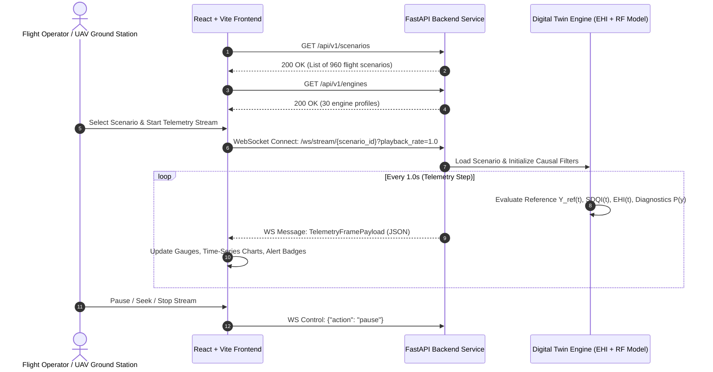

# ENGINE-TWIN — Frontend-to-Backend Interface Contract

**Document ID:** `ET-DOC-API-001`  
**Version:** 1.0.0  
**Date:** 2026-10-14  
**Author:** Antigravity Senior Python/ML Engineer & Project Architect  
**Scope:** Interface specification between the Python/FastAPI digital twin backend (`backend/`) and React/Vite web application (`frontend/`).  

---

> [!IMPORTANT]
> **SIMULATION-FIRST DATA INTERFACE DISCLAIMER**  
> All API schemas, streaming payloads, diagnostic probabilities, and health metrics defined herein represent synthetic digital twin simulation outputs. They do not represent FAA/EASA certified airworthiness telemetry or physical engine avionics interfaces.

---

## 1. System Integration Overview

The ENGINE-TWIN digital twin system exposes a hybrid **REST + WebSocket** architecture:
- **REST APIs (`http://localhost:8000/api/v1`)**: Scenario selection, engine fleet discovery, historical report queries, batch evaluation, and configuration inspection.
- **WebSocket Stream (`ws://localhost:8000/api/v1/stream/{scenario_id}`)**: Real-time 1.0 Hz telemetry playback, streaming raw sensor measurements, dynamic reference predictions, dual-scale SDQI, and coverage-gated EHI updates.



---

## 2. WebSocket Streaming Contract

### 2.1. Endpoint Specification
- **URL:** `ws://<backend_host>:<port>/api/v1/stream/{scenario_id}`
- **Query Parameters:**
  - `playback_rate` (float, optional, default: `1.0`): Speed multiplier (`0.5`, `1.0`, `2.0`, `5.0`).
  - `start_time_s` (int, optional, default: `0`): Initial timestamp to stream.

### 2.2. Downlink Telemetry Frame Payload (`TelemetryFrame`)
Every second (or simulated time step), the backend transmits a JSON frame:

```json
{
  "scenario_id": "32dfa01a76903aea",
  "engine_id": "0b650165a452bd7e",
  "time_s": 42.0,
  "operating_phase": "climb",
  "operating_inputs": {
    "throttle_pct": 85.4,
    "altitude_m": 2450.0,
    "ambient_temp_c": 12.5,
    "ambient_pressure_pa": 75200.0,
    "air_density_kg_m3": 0.985
  },
  "raw_measurements": {
    "rpm": 4420.5,
    "manifold_pressure": 72500.0,
    "cht": 142.8,
    "egt": 485.2,
    "oil_temp": 68.4,
    "oil_pressure": 248.5,
    "fuel_flow": 0.00215,
    "power": 14.82,
    "torque": 32.05,
    "vibration": 0.42
  },
  "dynamic_reference": {
    "rpm": 4410.0,
    "manifold_pressure": 72100.0,
    "cht": 141.2,
    "egt": 480.0,
    "oil_temp": 67.8,
    "oil_pressure": 250.0,
    "fuel_flow": 0.00210,
    "power": 14.75,
    "torque": 31.95,
    "vibration": 0.38
  },
  "sensor_data_quality": {
    "composite_sdqi": 95.8,
    "worst_channel_sdqi": 92.4,
    "coverage_fraction": 1.0,
    "status": "NOMINAL",
    "channel_qualities": {
      "rpm": 1.0,
      "manifold_pressure": 1.0,
      "cht": 0.98,
      "egt": 0.95,
      "oil_temp": 0.96,
      "oil_pressure": 1.0,
      "fuel_flow": 0.92,
      "power": 0.97,
      "torque": 0.96,
      "vibration": 1.0
    }
  },
  "engine_health": {
    "ehi": 98.2,
    "ehi_raw": 98.4,
    "status": "BAND_1_NOMINAL",
    "baseline_status": "CALIBRATED_NOMINAL",
    "operating_mode": "NORMAL",
    "channel_health": {
      "rpm": 1.0,
      "manifold_pressure": 0.99,
      "cht": 0.98,
      "egt": 0.98,
      "oil_temp": 1.0,
      "oil_pressure": 1.0,
      "fuel_flow": 0.96,
      "power": 0.98,
      "torque": 0.98,
      "vibration": 1.0
    }
  },
  "diagnostics": {
    "active_prediction": "normal",
    "predicted_probability": 0.942,
    "alert_level": "NOMINAL",
    "class_probabilities": {
      "normal": 0.942,
      "combustion_irregularity": 0.021,
      "thermal_abnormality": 0.012,
      "efficiency_degradation": 0.008,
      "sensor_bias": 0.005,
      "sensor_drift": 0.006,
      "sensor_stuck": 0.003,
      "sensor_dropout": 0.003
    }
  },
  "alerts": []
}
```

---

## 3. REST API Endpoint Specification

### 3.1. Fleet & Scenario Discovery
- `GET /api/v1/scenarios`
  - Query parameters: `page`, `page_size`, `split`, `fault_type`, `engine_id`, `operating_phase`.
  - Response: Paginated list of scenario summaries.
- `GET /api/v1/scenarios/{scenario_id}`
  - Response: Full scenario metadata (flight profile, engine specs, fault onset).
- `GET /api/v1/engines`
  - Response: List of all 30 engines in the engine pool (displacement, rated RPM, idle RPM).

### 3.2. Diagnostic Model Inference
- `POST /api/v1/diagnostics/predict`
  - Body: JSON containing 29 or 69 engineered features.
  - Response: Predicted fault class, confidence, and 8-class probability distribution.

### 3.3. Digital Twin Health Assessment
- `POST /api/v1/health/evaluate-frame`
  - Body: Single telemetry frame (operating conditions + 10 physical sensor channels).
  - Response: Instantaneous EHI, dual SDQI, channel qualities, and status band.

---

## 4. Frontend Component Mapping

| UI Component | Data Source | Visual Representation | Target Refresh Rate |
|---|---|---|---|
| **EHI Gauge & Band** | `engine_health.ehi`, `status` | Radial Gauge (0–100) with color bands (Green, Yellow, Orange, Red) | 1.0 Hz |
| **Dual SDQI Cards** | `sensor_data_quality` | Metric cards displaying `composite_sdqi` and `worst_channel_sdqi` | 1.0 Hz |
| **Primary Flight Display (PFD)** | `operating_inputs` | Throttle lever position, altimeter, ambient temperature | 1.0 Hz |
| **Physical Telemetry Strip Charts** | `raw_measurements` vs. `dynamic_reference` | 10 dual-line charts comparing measured vs. digital twin expected reference | 1.0 Hz |
| **Fault Diagnostic Radar** | `diagnostics.class_probabilities` | Polar radar chart or probability bar chart across 8 fault classes | 1.0 Hz |
| **Alert Log Banner** | `alerts` | Toast notifications and scrolling event log with acknowledged states | On Event |
